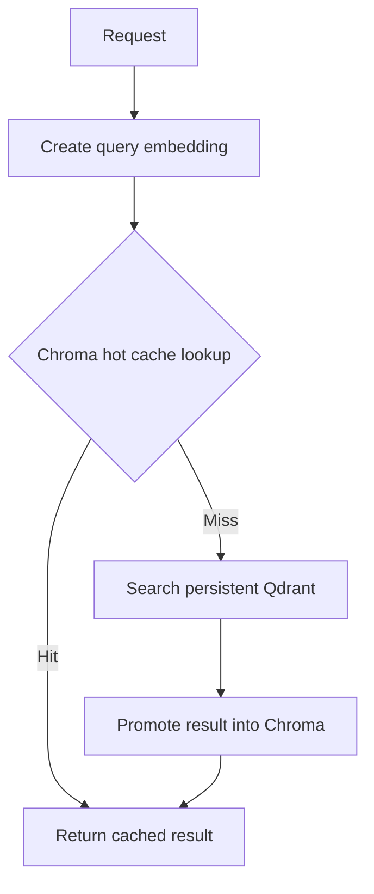

# Tiered vector cache and database

This POC demonstrates the request path:



The process-local Chroma vector store holds recently retrieved query/result pairs. Qdrant local persistent storage is the durable source of truth. A repeated query demonstrates the cache hit; the cache is intentionally empty after process restart, while Qdrant remains persisted.

Embeddings use OpenAI's `text-embedding-3-small`. Set `OPENAI_API_KEY`, and optionally `EMBEDDING_MODEL` or `QDRANT_PATH`.

```powershell
python -m venv .venv-vector-tiered
.\.venv-vector-tiered\Scripts\Activate.ps1
python -m pip install -r agents\vector\tiered\requirements.txt
$env:OPENAI_API_KEY = "your-provider-key"
python -m agents.vector.tiered.main --demo
python -m agents.vector.tiered.main "portable computer for a trip"
```

In demo mode, the same semantic query is requested twice in one process. The first request should miss the cache, query Qdrant, and promote the result; the second should hit the hot cache.

This is only a learning example. A real tiered system needs a workload-tuned cache threshold, cache sizing/eviction, invalidation on source-data updates, tenant isolation, metrics, and concurrency-safe shared cache/database services. Similarity-based result caching can return a result for a merely related query, so calibrate the threshold against labeled queries before using it for user-facing answers.

The query embedding is still computed before the cache lookup, so the in-memory vector index does not remove embedding-model latency. Measure embedding and retrieval separately before describing the overall path as low latency.
